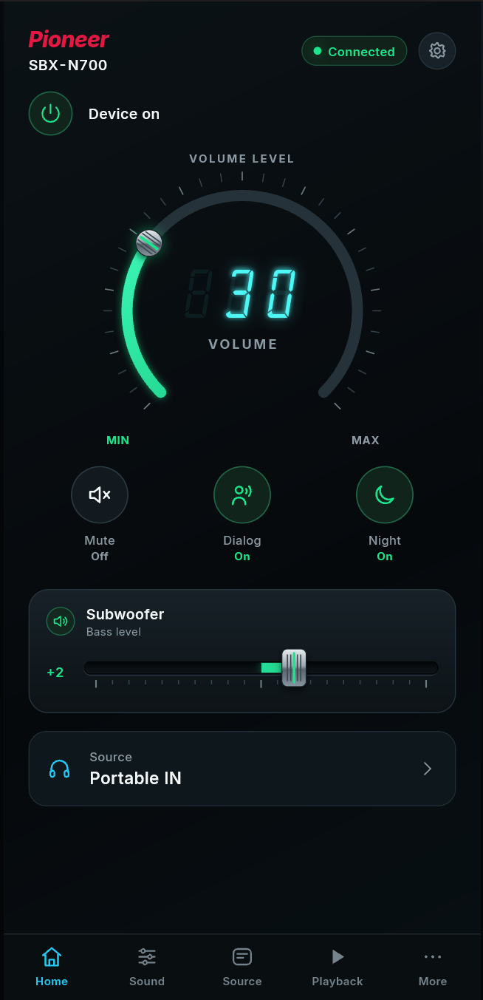
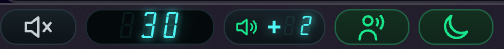
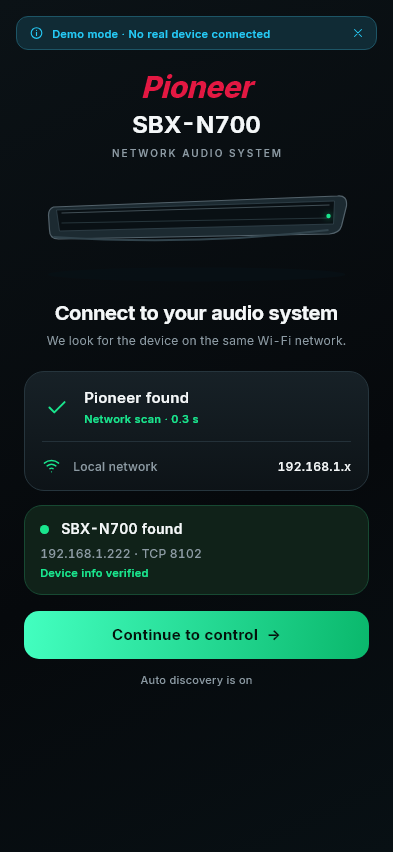
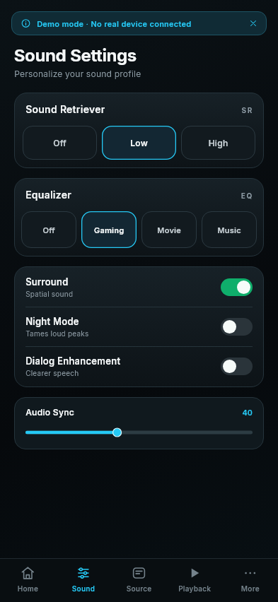
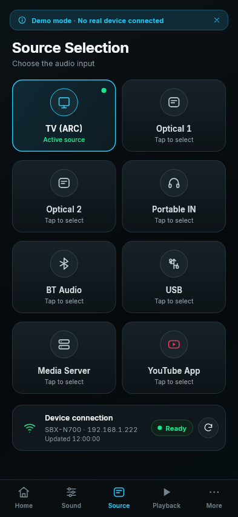
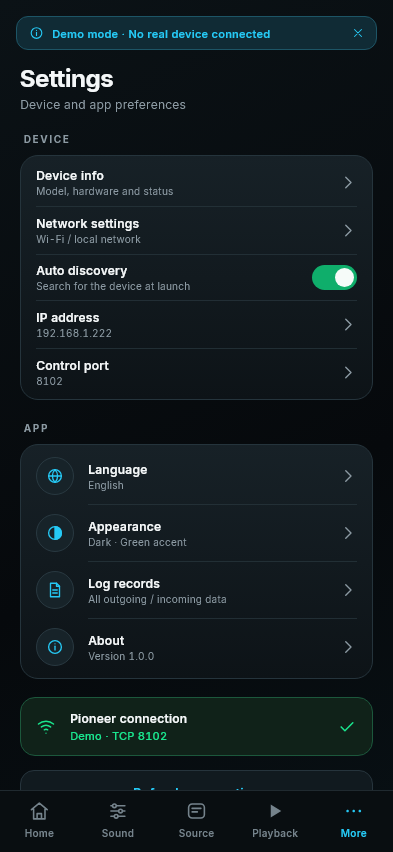

<div align="center">

# Pioneer SBX-N700 Remote

**An open-source remote control for the Pioneer SBX-N700 and SBX-N500 network soundbars.**
Volume dial, subwoofer, Dialog, Night mode, inputs and sound settings, plus a Windows 11 taskbar widget.


 &nbsp;&nbsp;


</div>

---

## Why this project exists

Pioneer's official **Control App** for these soundbars has been **removed from the mobile app stores**. Owners of
the SBX-N700 and SBX-N500 were left without a supported way to control their device from a phone or a computer.

Pioneer SBX Remote fills that gap. It talks to the soundbar directly over your network using the same simple
text protocol the original app used (observed from the control traffic on the local network and then verified
against a real device), wrapped in a modern, themed interface.

> **Unofficial project.** This app is not affiliated with, endorsed by, or supported by Pioneer. *Pioneer* and
> the model names are trademarks of their respective owners and are used here only to describe compatibility.

## Features

| | |
|---|---|
| **Automatic discovery** | Finds the soundbar on your network by itself (last known address, then a fast parallel scan of the local subnet, verified through the device's `description.xml`). On the first launch it connects automatically. |
| **Manual IP entry** | If discovery fails (other subnet, VLAN, firewall) you can type the address; the device is verified before connecting. |
| **Volume dial** | Draggable dial, mouse wheel and keyboard control, with a retro **VFD** (vacuum fluorescent display) readout. |
| **Subwoofer fader** | A mixer-style fader from -10 to +10. |
| **Mute, Dialog, Night** | One-tap buttons with clear state. Mute pulses red like a heartbeat while active. |
| **Sound settings** | Sound Retriever (Off / Low / High), equalizer (Off / Gaming / Movie / Music), Surround, Audio Sync. |
| **Input selection** | TV (ARC), Optical 1, Optical 2, Portable IN, Bluetooth, USB, Media Server and YouTube. |
| **Truthful buttons** | Buttons never guess. A command is sent, the button shows a busy ring, and its state changes only when the soundbar's reply arrives. The state is also re-read periodically and when you switch tabs. |
| **Windows taskbar widget** | A transparent control strip docked at the bottom-left of the Windows 11 taskbar: Mute, volume, subwoofer, Dialog and Night, with pop-up vertical faders. See [below](#windows-taskbar-widget). |
| **System tray** | With the widget enabled the main window lives in the tray; click the icon to bring it back. |
| **Multi-language** | English (default) and Turkish, with a standard ARB based structure that makes adding languages trivial. |
| **Demo mode** | A built-in soundbar simulator, so you can explore the app without a device. |
| **Diagnostics** | Every command and reply is logged (in-app log viewer and a daily log file). |

<details>
<summary><b>More screenshots</b></summary>

<p align="center">
  
  
  
  
</p>

</details>

## Compatibility

| Device | Status |
|---|---|
| Pioneer **SBX-N700** | Supported, developed and tested on real hardware |
| Pioneer **SBX-N500** | Supported (same control interface) |

**Networks.** The app works on **any network**, as long as the remote (network control) feature of the soundbar
is enabled and the device is reachable from your computer. Automatic discovery scans your local subnet; for
anything else (another subnet, a VLAN, a routed network) enter the soundbar's IP address manually.

> The soundbar accepts a single control connection at a time. Close any other remote app before connecting.

## Platform status

Everything has so far been **tested on Windows only**.

| Platform | Status |
|---|---|
| Windows 11 (x64) | Tested |
| Windows 10 (x64) | Expected to work, not yet verified |
| **Taskbar widget** | **Windows 11 only** (tested on Windows 11 x64) |
| Android, iOS | Not yet tested |
| macOS, Linux | Not yet tested |
| Windows on ARM | Not yet tested |

The Flutter code base is cross-platform, but until each platform has been tested and polished, please treat
everything other than Windows as unsupported. See the [roadmap](#roadmap).

## Install

### Windows

1. Download the latest installer from the **Releases** page of this repository and run it
   (`PioneerSBXN700-Setup-x.y.z.exe`). No administrator rights are required.
2. Start **Pioneer SBX Remote**. It searches your network and signs in to the soundbar automatically.

Prefer to build it yourself? See [Build from source](#build-from-source).

## Windows taskbar widget

Enable it in **Settings → Taskbar widget**. A small, transparent strip appears at the bottom-left corner of the
taskbar and the main window moves to the system tray.

| Control | What it does |
|---|---|
| **Mute** | Flush against the bottom-left corner of the screen, so you can throw the mouse into the corner and click. Pulses red while muted. |
| **Volume** | VFD readout of the volume. Scroll the mouse wheel to change it (hold Shift for steps of 5). Click it to open a vertical volume fader. |
| **Subwoofer** | Shows the bass level on a small VFD. Click it to open a vertical subwoofer fader. |
| **Dialog / Night** | Toggle buttons that light up when active. |

Technical notes:

- The widget is a second Flutter engine hosted by a native Win32 window (C++). The native layer handles window
  placement against the taskbar (`FindWindow`, `GetWindowRect`, `SetWindowPos`, `MonitorFromWindow`), transparency
  (`DwmExtendFrameIntoClientArea`), click-through regions (`SetWindowRgn`) and tracking
  (`SetWinEventHook`). The buttons themselves are defined in Dart.
- It never steals focus from the app you are working in, hides itself for full-screen apps and for an auto-hidden
  taskbar, and follows resolution and DPI changes.
- Limitations: a bottom, full-width taskbar on the primary monitor. If the Windows 11 *Widgets* button is
  enabled it covers the same corner, so turn it off.
- **Customize the buttons** without touching any native code with `%APPDATA%\PioneerSBXN700\taskbar_widget.json`:

  ```json
  {
    "items": [
      { "type": "mute" },
      { "type": "volume" },
      { "type": "subwoofer" },
      { "type": "dialog" },
      { "type": "night" }
    ]
  }
  ```

  Available types: `mute`, `volume`, `subwoofer`, `dialog`, `night`, `power`, `volumeUp`, `volumeDown`.

## Build from source

Requirements: [Flutter](https://docs.flutter.dev/get-started/install) (stable channel) and, for Windows,
Visual Studio with the *Desktop development with C++* workload.

```bash
git clone <this repository>
cd pioneer_sbx700_mobile
flutter pub get
flutter run -d windows                                   # real soundbar
flutter run -d windows --dart-define=PIONEER_DEMO=true   # built-in simulator
```

Other useful commands:

```bash
flutter analyze
flutter test                                    # unit, widget, TCP and golden tests
flutter test test/golden --update-goldens       # refresh screenshot references
flutter build windows --release                 # build/windows/x64/runner/Release/
powershell -ExecutionPolicy Bypass -File installer/build_installer.ps1   # single setup.exe (needs Inno Setup 6)
```

Build-time switches (`--dart-define=NAME=value`):

| Name | Effect |
|---|---|
| `PIONEER_DEMO=true` | Use the soundbar simulator instead of a real device. |
| `PIONEER_DEMO_DISCOVERY_FAILS=true` | (Demo) show the "device not found" screen. |
| `PIONEER_MEDIA_SCREENS=true` | Enable the unfinished Network Music / Now Playing screens. |

### Files the app creates

| Path | Content |
|---|---|
| `%APPDATA%\PioneerSBXN700\settings.json` | Last address, port, language, auto-discovery, widget on/off. |
| `%APPDATA%\PioneerSBXN700\taskbar_widget.json` | Optional widget button layout. |
| `%APPDATA%\PioneerSBXN700\logs\pioneer_YYYY-MM-DD.log` | Every command sent and reply received. |

## How it works

```
 ┌────────────────────────── Flutter UI ──────────────────────────┐
 │  screens  ·  dial / VFD / fader widgets  ·  AppController       │
 └───────────────┬───────────────────────────────┬─────────────────┘
                 │ PioneerRepository             │ DeviceDiscovery / DeviceProbe
        ┌────────▼─────────┐             ┌───────▼──────────────┐
        │ TcpPioneerRepo   │             │ NetworkDeviceDiscovery│
        │ (one persistent  │             │ (description.xml on   │
        │  TCP session)    │             │  TCP 38400)           │
        └────────┬─────────┘             └──────────────────────┘
                 │ text protocol, TCP 8102
           Pioneer soundbar
```

- **One persistent TCP connection** to the soundbar (port `8102`). Commands end with `CR`, replies arrive
  asynchronously as lines. Commands are paced (~75 ms) and user actions take priority over status polling.
- **Discovery** never touches the control port: it reads `http://<ip>:38400/description.xml` to recognise the
  device and learn the control port, so it does not disturb an existing session.
- **No absolute volume command exists**, so a target volume or bass level is translated into the right number of
  step commands (`VU`/`VD`, `SWU`/`SWD`) while the UI follows your finger immediately.
- The soundbar reports some switches with inverted values (for example `PWR0` means *on* and `MUT0` means
  *muted*); this is resolved in a single place, `lib/services/pioneer_protocol.dart`.

<details>
<summary><b>Protocol cheat sheet</b></summary>

| Function | Query | Command | Reply |
|---|---|---|---|
| Power | `?P` | `PO` / `PF` | `PWR0` = on, `PWR1` = off |
| Volume | `?V` | `VU` / `VD` | `VOL029` |
| Mute | `?M` | `MO` / `MF` | `MUT0` = muted, `MUT1` = sound on |
| Subwoofer | `?SW` | `SWU` / `SWD` | `SW10` = 0 (scale -10 ... +10 maps to `SW00` ... `SW20`) |
| Sound Retriever | `?ATA` | `0ATA` / `1ATA` / `2ATA` | `ATA0..2` (Off / Low / High) |
| Equalizer | `?S` | `0000SR` ... `0003SR` | `SR0000..3` (Off / Gaming / Movie / Music) |
| Surround | `?VDP` | `0VDP` (on) / `1VDP` (off) | `VDP0` = on |
| Night mode | `?SBA` | `0SBA` (on) / `1SBA` (off) | `SBA0` = on |
| Dialog | `?SBB` | `0SBB` (on) / `1SBB` (off) | `SBB0` = on |
| Audio Sync | `?SBC` | `050SBC` | `SBC050` (0-100, steps of 10) |
| Input | `?F` | `00FN` TV, `02FN` Optical 1, `03FN` Optical 2, `04FN` Portable, `05FN` Bluetooth, `06FN` USB, `12FN` Media Server, `13FN` YouTube | `FN04` |
| Identity | `?RGD` | | `RGD<000><SBX-N700/PWSYXE8>` |

Notes: Optical 2 (`03FN`) currently needs to be sent twice to take effect, which the app does for you.
</details>

## Project layout

```
lib/
  app.dart, main.dart, app_info.dart, app_config.dart
  l10n/            ARB translation files (app_en.arb is the template) + generated code
  models/          device state, inputs, connection models
  services/        protocol, TCP repository, discovery, probe, simulator, settings store
  state/           AppController (the single source of UI state)
  screens/         discovery, home, sound, source, remote, library, now playing, settings
  taskbar/         Windows taskbar widget (overlay UI, layout, bridge)
  widgets/         dial, VFD readout, fader, common components
windows/runner/    taskbar_overlay.cpp (Win32 overlay window), tray_icon.cpp
installer/         Inno Setup script and build script
test/              unit, widget, TCP (fake device over a real socket) and golden tests
```

## Roadmap

Everything above is tested on Windows. The following is planned for later, as time and interest allow:

- [ ] **Testing and polish on more platforms:** Android, iOS, macOS, Linux and Windows on ARM. The Windows
      taskbar widget is Windows-only by nature; equivalent quick-control surfaces for other platforms (for example
      a macOS menu-bar item, Android widgets and notifications) will be explored.
- [ ] **Store releases:** if the project gets enough interest, publish it to the mobile app stores (Google Play
      and the App Store) so owners can get a supported-looking replacement for the removed official app.
- [ ] A proper remote-control pad (D-pad, back, home, options) and playback controls, once the IR/remote key
      codes have been verified.
- [ ] Now Playing and Network Music screens (already designed, currently disabled).
- [ ] More languages (the translation structure is ready; contributions are welcome).
- [ ] Verify the subwoofer extremes and Optical 2 behaviour on more devices.
- [ ] Multiple soundbars, and a light theme.

## Contributing

Issues and pull requests are welcome, especially:

- test reports from **SBX-N500** owners and from non-Windows platforms,
- new translations (copy `lib/l10n/app_en.arb` to `app_<code>.arb`),
- protocol findings (commands, replies, unusual firmware behaviour).

Please run `flutter analyze` and `flutter test` before opening a pull request.

## Troubleshooting

- **"Device not found".** Make sure the computer and soundbar can reach each other and that the soundbar's remote /
  network control feature is enabled. If they are on different subnets or a VLAN, use *Enter the IP address
  manually*. Check that your firewall allows TCP ports `38400` and `8102` to the soundbar.
- **Connected but nothing changes.** Another remote app may be holding the soundbar's single control connection.
  Close it and use **Settings → Refresh connection**.
- **The taskbar widget is hidden.** It hides itself for full-screen apps and while the taskbar is auto-hidden.
  Make sure the taskbar is at the bottom of the primary monitor.
- Details of every command and reply are in the log file and under **Settings → Log records**.

## Acknowledgements

- [Flutter](https://flutter.dev) for the UI toolkit.
- [Inter](https://rsms.me/inter/) typeface, SIL Open Font License 1.1.
- [VFDigit](https://github.com/jz5/fonts-vfdigit) VFD-style digits by Pronama, SIL Open Font License.

## Author

**Soylu Oltu KAYA**

- GitHub: [github.com/soyluoltu](https://github.com/soyluoltu)
- Web: [www.canliol.com](https://www.canliol.com)

## License

Released under the [MIT License](LICENSE). Copyright © 2026 Soylu Oltu KAYA.

Pioneer is a trademark of its respective owner. This project is an independent, unofficial community effort and
comes with no warranty.
